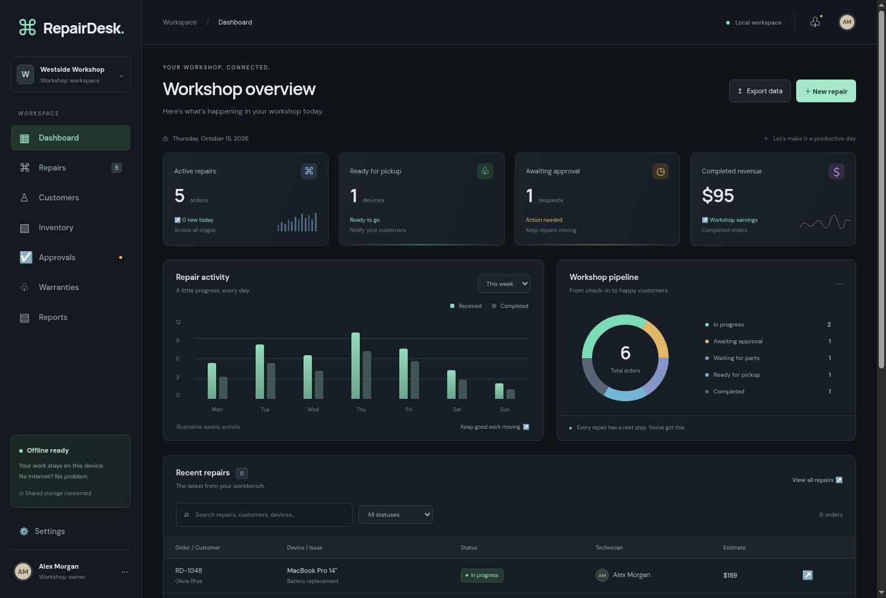
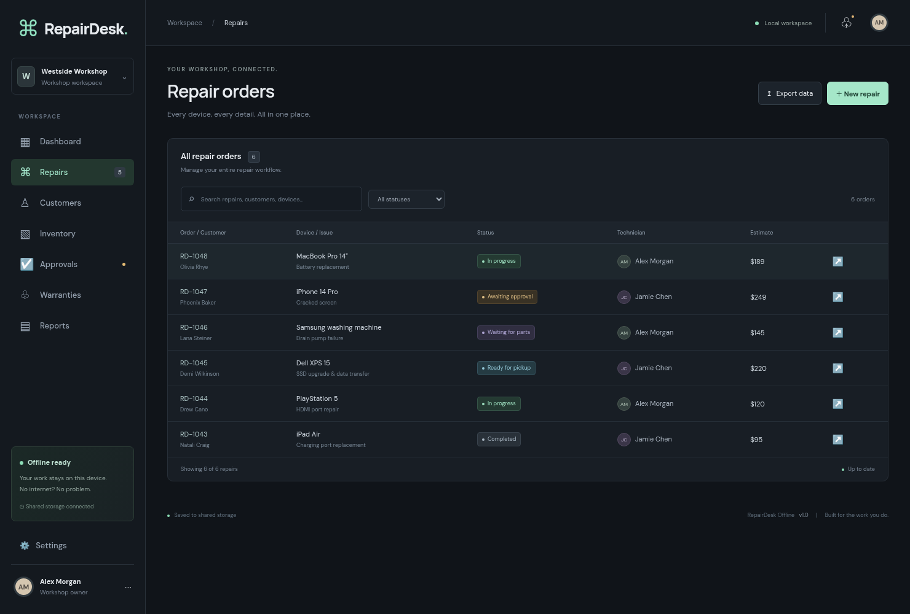
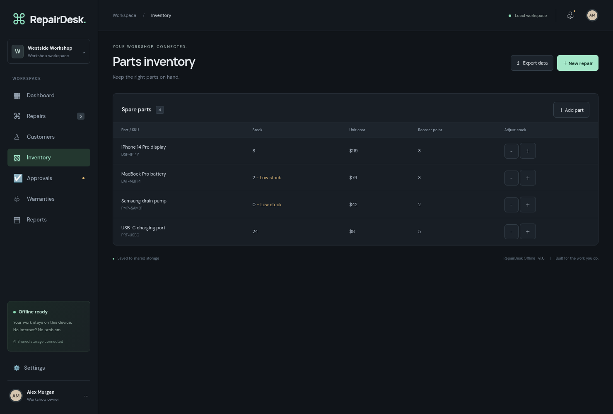

# RepairDesk Offline

A workshop management application with repairs, customers, parts inventory, manually recorded approvals, 90-day service warranties, printable reports and JSON backup/restore. Sample records are included. The weekly activity chart is illustrative; revenue and order counts reflect saved records.

## Previews and demo

Screenshots from the running application with its included sample records:







### Try the workflow

1. Start the desktop app, then choose **File → Open in browser**.
2. In either interface, open **Repairs**, choose **New repair**, enter a customer, device, issue and estimate, and save.
3. Search for the order in the other interface. Changes appear automatically within about two seconds when no editing dialog is open.
4. Explore **Inventory** to adjust stock and **Approvals** to record customer approval.
5. Open **Settings → Download backup** to export your shared records as JSON.

Sample data is for demonstration. Browser and desktop changes affect the same dataset. For an isolated demo, start development with `REPAIRDESK_DATA_DIR` pointing to a separate folder.

## One persistent store for browser and desktop

Both interfaces use one local service and one persistent `workshop.json` file, rather than separate browser localStorage databases. On Windows, records are stored under `%APPDATA%\RepairDesk Offline\shared-data`. On macOS, the folder is `~/Library/Application Support/RepairDesk Offline/shared-data`; on Linux it is `$XDG_DATA_HOME/RepairDesk Offline/shared-data` (default `~/.local/share`). `REPAIRDESK_DATA_DIR` overrides the folder for development and tests.

Keep the desktop app running while using the browser. Choose **File → Open in browser**, or enter `http://127.0.0.1:43127` on the same computer. The service listens only on loopback and needs no Internet connection. Closing the desktop app stops its service unless a separate `npm run serve` process owns it. Restarting the app restores the same file. Uninstalling preserves this data folder.

Writes use a temporary file and atomic replacement; `workshop.json.previous` retains the previous version. Export backups regularly. Concurrent stale edits are rejected and the latest records are reloaded, so another window's changes cannot be silently overwritten. Connection failures show an error and never fall back to a separate browser store.

This shares data between interfaces on **one computer**. Cross-computer sync requires a hosted service and is not included.

### Migrate existing records

Export backups before updating. Old records are preserved until you explicitly import them:

- For old browser data, open the same browser profile and development address used previously, then choose **Settings → Import previous browser data**. On first connection to an empty shared store, you can also accept the import prompt.
- For old desktop data, choose **File → Import previous desktop records** in the updated desktop app.
- Alternatively, restore an exported JSON backup in **Settings**.

Import replaces the shared dataset for both interfaces; it does not merge datasets. The previous shared version is retained in `workshop.json.previous`. The old browser localStorage record is left intact. Browsers cannot read another profile's previous localStorage; use its exported backup instead.

## Development

Requires Node.js 22.12+ (Node 24 recommended).

```sh
npm ci
npm run dev
```

Development starts the shared service and Vite together, using the same data directory as the desktop app. Vite proxies API requests to the local service. If the desktop app already owns the service, close it before starting development so the development origin can be enabled. `npm test` exercises persistence, corruption handling, conflicts and HTTP access restrictions.

`npm run build` produces the web bundle. `npm run serve` serves that bundle with shared storage for browser-only use. `npm run desktop` builds and opens the Electron app. Fonts and runtime assets are bundled.

## Windows install and uninstall

On Windows, run `npm ci` then `npm run dist:win`. The NSIS installer is written to `release/`. It supports installation directory selection and desktop shortcuts. Uninstall through **Windows Settings → Apps**, or the installed uninstaller. Export backups before uninstalling; uninstall is not a secure data-erasure operation.

The [Windows installer workflow](.github/workflows/windows-installer.yml) builds a downloadable artifact when run manually. Pushing a `v*` tag also publishes the installer to GitHub Releases. Existing release assets are not overwritten. GitHub API access is required to publish; an artifact built locally has not automatically been uploaded.

### Compile on Linux without Wine

The native NSIS helper builds an unsigned installer with folder selection, desktop and Start menu shortcuts, and a registered uninstaller. It removes only the packaged files and shortcuts during uninstall, preserving the shared data folder and unrelated files.

```sh
npm run build
npx electron-builder --win dir
# Download electron-builder's checksum-verified NSIS toolset:
node -e "require('app-builder-lib/out/toolsets/windows').getMakeNsisPath().then(tool => console.log(tool.path))"
# Pass the absolute makensis path printed above:
python docs/build-installer.py /absolute/path/to/nsis/linux/makensis
```

The installer is `release/RepairDesk Offline Setup 1.0.0.exe`. Python 3 is required for this Linux helper. Installation and uninstallation still require verification on Windows before distribution.

Unsigned builds can trigger Windows SmartScreen or antivirus reputation prompts. Configure code-signing credentials securely for production distribution.

## Limitations

Currency is USD. Approvals are recorded by workshop staff after customer contact, without sending messages. Warranties cover a fixed 90-day period from completion. No cross-computer sync, authentication, payment processing or automatic customer messaging is included. The local service is intended for the signed-in computer user; do not expose it to a LAN or the Internet.
